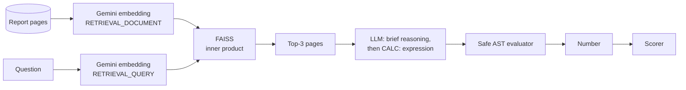
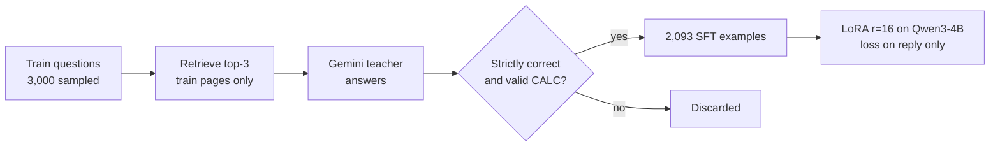

# FinQA-RAG-LoRA

**Retrieval-augmented question answering over financial reports, and distilling a frontier model's reasoning into a 4B open model with LoRA.**

A fine-tuned Qwen3-4B, trained on 0.8% of its parameters for about 5 GPU-hours (~$6), went from **58.0% to 65.0%** accuracy on financial-report questions (+7.0 pts, p = 0.002). That matches its Gemini teacher (66.0%) within the margin of error.

| Model (k = 3 retrieved pages) | Strict accuracy | Lenient | Valid `CALC` line |
|---|---:|---:|---:|
| Qwen3-4B-Instruct-2507, base | 58.0% | 61.3% | 93.3% |
| **Qwen3-4B + LoRA (distilled)** | **65.0%** | **68.0%** | **97.3%** |
| Gemini 3.5 Flash-Lite (teacher) | 66.0% | 68.7% | 97.0% |

*300 held-out test questions from T²-RAGBench FinQA. All three models use the same prompt, the same retrieved pages and the same scorer.*

## The task

[T²-RAGBench](https://huggingface.co/datasets/G4KMU/t2-ragbench) FinQA: questions about real company annual reports (e.g. *"What was the percentage change in net revenue from 2015 to 2016?"*). Each answer needs the right page, which mixes prose and a table, and then usually a calculation. The system must:

1. **Retrieve** the right page from a corpus of report pages, all from similar-looking filings.
2. **Read** a table and text, picking the right company, year and row.
3. **Compute** the answer correctly.

## Pipeline



- **Retrieval:** `gemini-embedding-2` (3,072 dimensions), with separate task types for documents and queries. Normalized vectors in a FAISS `IndexFlatIP` give cosine similarity. Evaluated with Recall@k and MRR.
- **Program-of-thought answers:** the model doesn't do arithmetic in its head. It ends with `CALC: (705.4 - 696.3) / 696.3`, which an AST-based evaluator computes. The evaluator allows only numbers, `+ - * /` and parentheses, so model output is never `eval()`'d.
- **Scoring:** *strict* means within 1% relative tolerance (absolute tolerance for zero labels). *Lenient* also accepts ×100 and ÷100, because the labels mix 0.15 and 15 for percentages. Sign-flip errors are tracked separately for error analysis.

## Distillation and LoRA



- **Rejection sampling:** only teacher answers that are strictly correct and end in a valid `CALC` line are kept: 2,093 of 3,000 (about 70%). The student never learns from the teacher's mistakes.
- **No leakage:** training retrieval searches only pages that don't appear in the test or dev sets. If retrieval misses the gold page, it is inserted, so every example teaches reading a page that contains the answer.
- **Train like you test:** the training prompts use the same system prompt, the same top-3 retrieved pages and the same format as evaluation.
- **Completion-only loss:** the loss covers only the assistant reply, so the model learns to reason and answer, not to reproduce documents. A unit test checks the token mask.
- **Drop, don't truncate:** 111 examples longer than 5,120 tokens were removed. Truncating them would have cut off the reply, which is the only part trained on.

| Setting | Value |
|---|---|
| Base model | `Qwen/Qwen3-4B-Instruct-2507`, bf16 |
| LoRA | r = 16, α = 32, dropout 0.05, all attention and MLP projections |
| Trainable parameters | 33.0M of 4.06B (0.81%) |
| Data | 1,882 train / 100 validation examples |
| Schedule | 2 epochs, effective batch size 16, learning rate 2e-4 with cosine decay, gradient checkpointing |
| Hardware | 1× NVIDIA L4 (24 GB), Vertex AI custom job |
| Time and cost | 5.0 h, about $6 |
| Loss | train 0.245, validation 0.199 |

## Results

### Accuracy (strict, %)

| Model | Retrieved pages (k = 3) | Gold page (oracle) |
|---|---:|---:|
| Qwen3-4B base | 58.0 | 65.3 |
| Qwen3-4B + LoRA | **65.0** | **72.0** |
| Gemini 3.5 Flash-Lite | 66.0 | 71.0 |


### Retrieval (300 test questions)

| Recall@1 | Recall@3 | Recall@5 | Recall@10 | MRR |
|---:|---:|---:|---:|---:|
| 0.73 | **0.92** | 0.97 | 0.99 | 0.83 |

With k = 3, the gold page is in the prompt for 92% of questions. The 8% of misses explain most of the gap between retrieved and oracle accuracy. Recall@5 is 0.97, so passing 5 pages, or reranking the top 10, would recover most of that, at the cost of longer prompts.

## Engineering notes

- **Resumable everywhere.** Embedding, generation and training all save progress as they go and resume after a crash, a rate limit or preemption. Runs refuse to resume if their settings have changed.
- **A GPU guard.** An early job image had no CUDA runtime, so it ran silently on the CPU for hours. Every GPU job now checks for a GPU at startup and stops if none is visible. A test covers this.
- **Tested before spending GPU time.** 97 pytest tests, including end-to-end runs of generation, training and resume using a tiny randomly initialized Qwen3-architecture model on the CPU.
- **Reproducible configs.** Model IDs are pinned, decoding is greedy, the seed is fixed, and each run stores its settings next to its results.

## Reproduce

```bash
uv sync
# .env: GOOGLE_CLOUD_PROJECT=<project>, GOOGLE_CLOUD_LOCATION=global, GOOGLE_GENAI_USE_VERTEXAI=True

# Data, embeddings, retrieval
uv run python -m finqa_rag_lora.data
uv run python -m finqa_rag_lora.embed
uv run python -m finqa_rag_lora.eval_retrieval

# Gemini baseline
uv run python -m finqa_rag_lora.eval_qa --config configs/qa_gemini.yaml --mode retrieved --split test   # and --mode oracle

# Distillation data
uv run python -m finqa_rag_lora.retrieve_train
uv run python -m finqa_rag_lora.eval_qa --config configs/teacher.yaml --mode retrieved --split train --sample 3000
uv run python -m finqa_rag_lora.build_sft \
    --predictions results/qa/teacher_gemini_3.5_flash_lite_retrieved_train_sample3000/predictions.jsonl

# GPU: upload data/, results/retrieval_*.jsonl and configs/ to the bucket, then build the image, train, evaluate (Vertex AI custom jobs)
gcloud builds submit --region=us-central1 --tag us-central1-docker.pkg.dev/<project>/finqa/finqa-gpu:v4 .
gcloud ai custom-jobs create --region=us-central1 --display-name=train-lora --config=jobs/train_lora.yaml
gcloud ai custom-jobs create --region=us-central1 --display-name=eval-qwen-lora --config=jobs/eval_qwen_lora.yaml

# Compare
uv run python -m finqa_rag_lora.compare --runs qwen3_4b_base qwen3_4b_lora_r16 gemini_3.5_flash_lite
```

## Repository layout

```
src/finqa_rag_lora/
  data.py            load T²-RAGBench FinQA, build the page corpus, sample test/dev sets
  embed.py           Gemini embeddings with pacing, retries and resume
  retrieve.py        FAISS dense retriever
  eval_retrieval.py  Recall@k, MRR, miss analysis
  prompts.py         the shared prompt and CALC parser
  calc.py            safe arithmetic evaluator (AST, no eval)
  scoring.py         strict / lenient / sign-flip scoring
  generate.py        Gemini and Hugging Face generators (batched, LoRA adapters)
  eval_qa.py         QA runner: retrieved or oracle mode, resumable
  retrieve_train.py  leakage-free retrieval for training questions
  build_sft.py       rejection sampling, then SFT examples
  train_lora.py      LoRA training with TRL (loss on the reply only)
  gpu_entry.py       Vertex AI job entry point: stage from GCS, run, sync back
  compare.py         paired comparison (McNemar, bootstrap CI)
configs/             one YAML per run
jobs/                Vertex AI custom-job specs
tests/               pytest suite
results/             metrics and comparison (committed); predictions are not
```

## Limitations

- **300 test questions.** Gaps of about 4 points or less can't be resolved, so the "matches the teacher" claim is about being indistinguishable, not equal.
- **Label noise.** Some FinQA labels mix percentage and fraction formats or have sign conventions that don't match the question. The lenient score and the sign-flip counter make this visible; they don't fix it.
- **One teacher, one seed.** A single training run. No comparison of LoRA ranks or of training on gold-only versus retrieved context.
- **Single benchmark.** Not yet tested on other T²-RAGBench subsets (e.g. TAT-DQA) to check generalization.